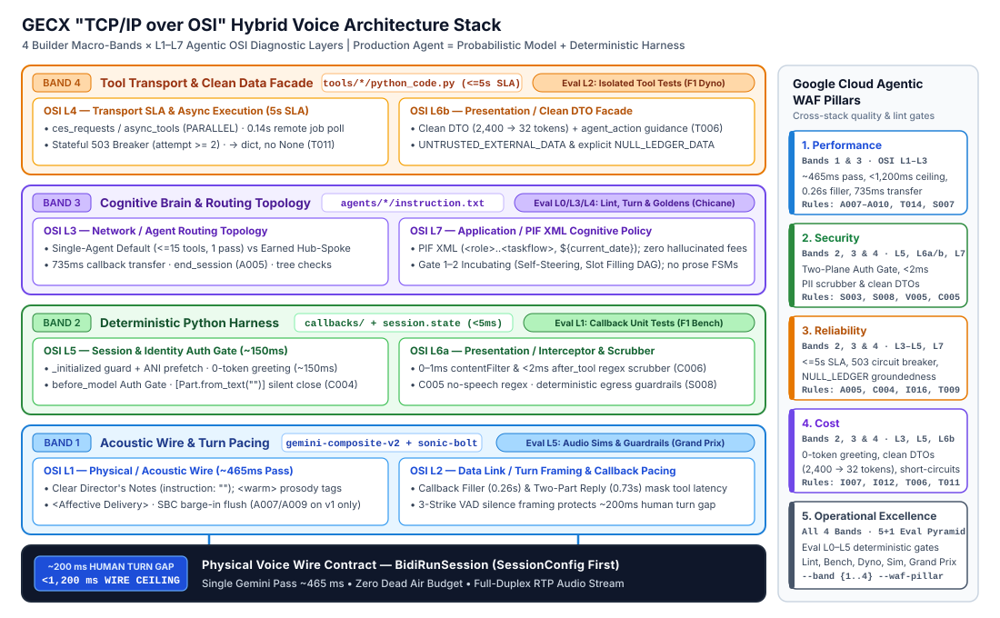

# Agent Architecture

The most common architecture mistake is adding agents prematurely. Multi-agent setups add real complexity — handoff logic, shared state, routing decisions — and that complexity has to be paid for in maintenance and debuggability. Start with a single agent and add agents only when the single-agent design demonstrates concrete limitations.

<figure class="diagram">
  
</figure>

---

## Single-agent

A single agent handles the entire conversation. All tools, instructions, and state live in one place.

### When to use

- The conversation follows a linear or near-linear flow
- State is simple enough to track in a handful of variables
- The agent has fewer than two distinct capabilities (e.g., one primary task with simple fallbacks)
- You're starting a new project and the full complexity isn't yet known

### Trade-offs

| Benefit | Limitation |
|---------|-----------|
| Simple to reason about — one instruction set, one state space | Instructions grow long as capabilities increase |
| Easy to test — all behavior in one place | A single very long instruction set degrades model reliability |
| Fast to build and iterate | Can feel awkward if the agent needs radically different personas for different tasks |
| No handoff logic to maintain | All tools visible in every turn, including irrelevant ones |

### Workspace structure

```
bella_notte/
├── gecx-config.json
├── cxas_app/
│   ├── app.json
│   ├── agents/
│   │   └── Bella_Notte_Host/
│   │       ├── Bella_Notte_Host.json
│   │       ├── instruction.txt
│   │       ├── before_agent_callbacks/
│   │       │   └── before_agent_callbacks_01/
│   │       │       └── python_code.py
│   │       └── before_model_callbacks/
│   │           └── before_model_callbacks_01/
│   │               └── python_code.py
│   ├── tools/
│   │   ├── set_party_size/
│   │   │   ├── set_party_size.json
│   │   │   └── python_function/
│   │   │       └── python_code.py
│   │   └── create_reservation/
│   │       ├── create_reservation.json
│   │       └── python_function/
│   │           └── python_code.py
│   └── evaluations/
│       └── Happy_Path_-_Linear_Flow/
│           └── Happy_Path_-_Linear_Flow.json
```

---

## Multi-agent

Multiple agents divide responsibility. One agent typically acts as the orchestrator (or "root agent"), routing the conversation to specialized sub-agents based on the user's intent.

### When to use

- Different parts of the conversation need genuinely different personas (e.g., a triage agent vs. a billing specialist)
- The full set of critical user journeys is too complex for one instruction set to handle reliably
- A single-agent prototype has been built and tested, and you've confirmed it degrades under the full scope
- You need strict capability isolation — sub-agents that cannot accidentally perform actions outside their domain

### Trade-offs

| Benefit | Limitation |
|---------|-----------|
| Each agent's instructions stay focused and short | Handoff logic is a new failure surface |
| Agents can have distinct personas and tool sets | State must be explicitly shared across agents |
| Easier to test sub-agents in isolation | Routing errors can cause confusing user experiences |
| Scales more gracefully to large capability sets | More files, more moving parts, harder to onboard |

### Workspace structure

```
my_agent/
├── gecx-config.json
├── cxas_app/
│   ├── app.json
│   ├── agents/
│   │   ├── Root_Agent/
│   │   │   ├── Root_Agent.json        # Orchestrator — routes to sub-agents
│   │   │   ├── instruction.txt
│   │   │   └── before_model_callbacks/
│   │   │       └── before_model_callbacks_01/
│   │   │           └── python_code.py
│   │   ├── Reservation_Agent/
│   │   │   ├── Reservation_Agent.json
│   │   │   └── instruction.txt
│   │   └── Cancellation_Agent/
│   │       ├── Cancellation_Agent.json
│   │       └── instruction.txt
│   ├── tools/
│   │   ├── check_availability/
│   │   │   ├── check_availability.json
│   │   │   └── python_function/
│   │   │       └── python_code.py
│   │   └── cancel_reservation/
│   │       ├── cancel_reservation.json
│   │       └── python_function/
│   │           └── python_code.py
│   └── evaluations/
│       └── Happy_Path/
│           └── Happy_Path.json
```

---

## How to decide

!!! info "Decision guide"
    Start with these questions:

    1. **Does this agent need more than one distinct persona?** If yes, lean toward multi-agent.
    2. **Does this agent have more than two substantially different capabilities?** If yes, single-agent instructions will grow long. Consider splitting.
    3. **Have you built a single-agent version?** If no, build one first. Real failure modes are easier to see in a working prototype than in a design document.
    4. **Is the single-agent version failing evals in ways that better instructions can't fix?** If yes, that's the signal to split.

The decision isn't permanent. A single-agent design can be refactored into multi-agent later. The reverse is harder. When in doubt, start simple.

---

## The "start simple" philosophy

Multi-agent architectures look appealing in design documents because they seem modular and clean. In practice, they introduce coordination problems that are hard to anticipate until you're debugging them in a failing eval.

The correct sequence is:

1. **Build a single-agent prototype.** Get it working against your core user journeys.
2. **Run evals.** Identify where it fails and why.
3. **Try to fix failures with better instructions, tools, or callbacks.** Most failures can be addressed this way.
4. **If you've exhausted those options**, and the root cause is genuinely that the instruction set is too large or the personas are too different, then split into multiple agents.

This sequence gives you a baseline to compare against. A multi-agent design that performs worse than the single-agent prototype is a signal that the problem was never architectural.

!!! warning "Avoid tool explosion"
    A common driver of premature multi-agent adoption is having too many tools. Before splitting into multiple agents, check whether you can reduce tool count instead. Tools with overlapping functionality, high-cardinality arguments, or poor naming are often better candidates for redesign than handoff. See [Tool Design](tool-design.md) for guidance.

---

## Layered Voice Architecture & Agentic Well-Architected Framework ("TCP/IP over OSI")

Whether you run a single agent or a shallow multi-agent hub, every production voice agent is a **probabilistic model wrapped inside a deterministic Python harness**. GECX organizes that system using a **"TCP/IP over OSI" Hybrid Voice Stack**: **4 Builder Macro-Bands** that map 1-to-1 to your `cxas_app/` directory layout and the 4-tier F1 Testing Pyramid, subdivided into **L1–L7 Agentic OSI Diagnostic Layers** for precision linting and failure attribution.



### First principle: the `<1,200ms` physical voice wire ceiling

Voice architecture begins at the physical telephony wire (`PSTN / SIP / SBC / RTP` full-duplex audio streams paired with Gemini Composite native audio targeting `<800ms` Time-to-First-Audio). In human phone conversation, unpaced silence past **`1,200ms`** registers as dead air—callers repeat themselves, barge in, or hang up.

Every upper-layer pattern in the stack exists to protect this `<1,200ms` conversational wire contract alongside security, groundedness, and token cost:

- **Acoustic & turn pacing (`Band 1`)** flushes stale audio buffers immediately on caller interruption (`bargeInAwareness: true`) and speaks `T014` conversational filler bridges (*"Tell them, then do it"*) before invoking network tools.
- **Deterministic interceptors (`Band 2`)** enforce authentication gates and scrub egress payloads in `<5ms` of pure Python instead of burning an extra LLM round-trip.
- **Shallow routing (`Band 3`)** avoids deep multi-agent handoff chains where each extra hop compounds turn latency.
- **Bounded tool transport (`Band 4`)** enforces `<=5s` client SLAs well inside the platform's `30s` execution harpoon and trips stateful circuit breakers on repeated `503` upstream failures.

### 4 Macro-Bands × L1–L7 Agentic OSI diagnostic matrix

Builders author code across **4 Macro-Bands** (ordered bottom-to-top from the physical wire to external backends), while `cxas lint`, `cxas llm-lint`, and `cxas evals report` pinpoint issues to the exact **Agentic OSI Layer (`L1`–`L7`)**:

| Macro-Band (Bottom → Top) | `cxas_app/` Artifact Scope | Agentic OSI Layers | Key Architectural Patterns & Lint Rules | F1 Testing Pyramid Gate |
|---|---|---|---|---|
| **Band 1 — Acoustic Wire & Turn Pacing** | `app.json` + Tool Pacing | **`OSI L1`** (Physical / Acoustic Wire)<br>**`OSI L2`** (Data Link / Turn Framing & Pacing) | • Gemini Composite `temperature: 1.0` (`A010`), concise Director's Notes (`A007`–`A009`), SBC barge-in buffer flush (`bargeInAwareness: true`)<br>• Spoken filler bridges before tool calls (`T014`) & 3-strike VAD silence framing (`E009`, `E012`, `V001`) | **Pyramid L4: Audio Grand Prix** (`cxas evals report --modality audio` + acoustic SNR noise presets) |
| **Band 2 — Deterministic Python Harness** | `callbacks/` + `session.state` (`<5ms`) | **`OSI L5`** (Session & Identity Gate)<br>**`OSI L6a`** (Presentation / Post-Tool Interceptor) | • `session.state` seeded in `before_agent_callback` (`V100`–`V103`) & synchronous `before_model_callback` returning `Optional[LlmResponse]` Auth Gate (`C001`–`C005`, `C010`, `S003`)<br>• `<2ms` `after_tool_callback` deterministic secret, PII & indirect prompt-injection scrubber (`C006`, `S008`, `V005`) | **Pyramid L2: Callback Bench** (`pytest` callback unit harness, `<5ms` budget) |
| **Band 3 — Cognitive Brain & Routing Topology** | `agents/*/instruction.txt` & `rootAgent` | **`OSI L3`** (Network / Agent Routing Topology)<br>**`OSI L7`** (Application / Cognitive XML Policy) | • Shallow Spoke-and-Hub topology (`S004`, `S007`), valid `{@AGENT: ...}` transfers (`I008`, `I010`), native `end_session` termination (`A005`, `A006`, `V002`)<br>• Canonical lowercase XML (`<role>`, `<constraints>`, `<taskflow>`, `{current_date}` `I014`–`I015`), zero prose FSMs (`I016`), strict groundedness on null or untrusted data | **Pyramid L3: Turn/Golden Chicane** (`cxas llm-lint` + deterministic Turn & Golden Evals) |
| **Band 4 — Tool Transport & Clean Data Facade** | `tools/*/python_code.py` (`<=5s` SLA) | **`OSI L4`** (Transport / Execution SLA & Circuit Breaker)<br>**`OSI L6b`** (Presentation / Clean DTO Facade) | • Bounded `<=5s` client timeout inside the `30s` platform harpoon, stateful `503` circuit breaker (`attempt >= 2`), strict Python signatures (`T001`, `T004`, `T007`–`T011`, `T013`, `V003`–`V004`)<br>• Sanitized DTO projection (*"It can't leak what it never saw"*, `T006`), `UNTRUSTED_EXTERNAL_DATA` tagging, explicit `NULL_LEDGER_DATA` envelopes (`T002`–`T003`, `T005`, `T012`) | **Pyramid L1: Tool Dyno** (`pytest` tool unit tests + `cxas lint --band 4`) |

!!! info "Why OSI Layer 6 splits across Bands 2 and 4 (`L6a` vs. `L6b`)"
    Presentation and data hygiene operate as a two-layer defense boundary around untrusted backends:

    - **`OSI L6b` (Band 4 — Clean DTO Facade)** strips internal database fields, raw stack traces, and excessive payload bloat inside `tools/*/python_code.py` *before* data leaves the tool, wrapping external text in `UNTRUSTED_EXTERNAL_DATA` envelopes and missing values in explicit `NULL_LEDGER_DATA` states.
    - **`OSI L6a` (Band 2 — Post-Tool Interceptor)** runs a deterministic `<2ms` `after_tool_callback` across all tools—including third-party OpenAPI or MCP toolsets you do not author directly—to redact residual secrets, PII, or prompt-injection payloads before the model ever sees `tool_response`.

### Mapping to the 5 Google Cloud Agentic WAF Pillars

Every architectural control and lint rule in the 4-Band stack aligns with one of the **5 Google Cloud Agentic Well-Architected Framework (WAF) Pillars**, allowing engineering teams to audit posture directly from the CLI (`cxas lint --waf-pillar <pillar>`):

| Google Cloud Agentic WAF Pillar | Primary Macro-Bands & OSI Layers | Architectural Controls & Verification |
|---|---|---|
| **Performance** | **Bands 1 & 3** (`OSI L1`, `L2`, `L3`, `L7`) | Protects the `<1,200ms` wire budget via Gemini Composite `temperature: 1.0` (`A010`), concise `<12`-word speaking style / Director's Notes (`A007`–`A009`), `T014` spoken bridge fillers, shallow single-parent sub-agent trees (`S007`), and callback-driven branching instead of heavy prompt `IF/ELSE` trees (`I003`, `I005`, `C005`). |
| **Security** | **Bands 2, 3 & 4** (`OSI L5`, `L6a`, `L6b`, `L7`) | Enforces **Two-Plane Security**: deterministic `before_model_callback` `LlmResponse` auth gates (`S003`), `<2ms` `after_tool_callback` PII/secret scrubbing and singleton `llmPromptSecurity` guardrails (`S008`, `V005`), sanitized `L6b` DTO projections, and canonical XML instruction boundaries (`I015`) that refuse `UNTRUSTED_EXTERNAL_DATA` overrides. |
| **Reliability** | **Bands 2, 3 & 4** (`OSI L3`, `L4`, `L5`, `L6b`, `L7`) | Prevents call drops and hallucinations through bounded `<=5s` client timeouts, stateful `503` circuit breakers, explicit `NULL_LEDGER_DATA` envelopes (so the model never guesses fees on `null`), declared `session.state` schemas (`V100`–`V104`), native `end_session` termination (`A005`), and eliminating fragile prose state machines (`I016`). |
| **Cost** | **Bands 2, 3 & 4** (`OSI L3`, `L4`, `L5`, `L6b`, `L7`) | Minimizes token and compute spend by short-circuiting unauthenticated or terminal turns in `<5ms` Python callbacks (`OSI L5`), keeping agent instructions focused (`I007`), pruning unreferenced tools from context (`I012`, `T008`), and projecting compact DTOs instead of returning raw API dumps (`T006`). |
| **Operational Excellence** | **All 4 Bands** (`OSI L1`–`L7` / Pyramid `L1`–`L4`) | Standardizes declarative layout (`S005`, `S006`), schema validation, shadow/simulation eval hygiene (`E001`–`E012`), semantic prompt reviews (`cxas llm-lint`), and layer-targeted CI gates (`cxas lint --band {1..4}` and `cxas lint --waf-pillar`). |

See the [Rule Reference](../guides/linting/rules.md) and [`cxas lint` CLI reference](../cli/lint.md) for complete rule-to-layer mappings and filtering commands.
